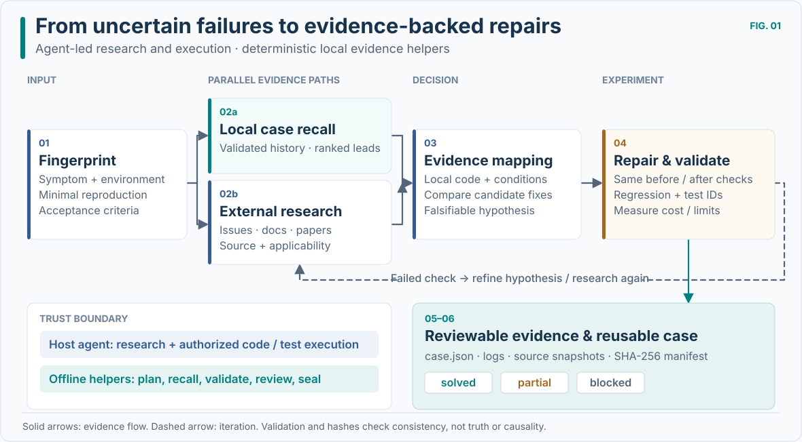
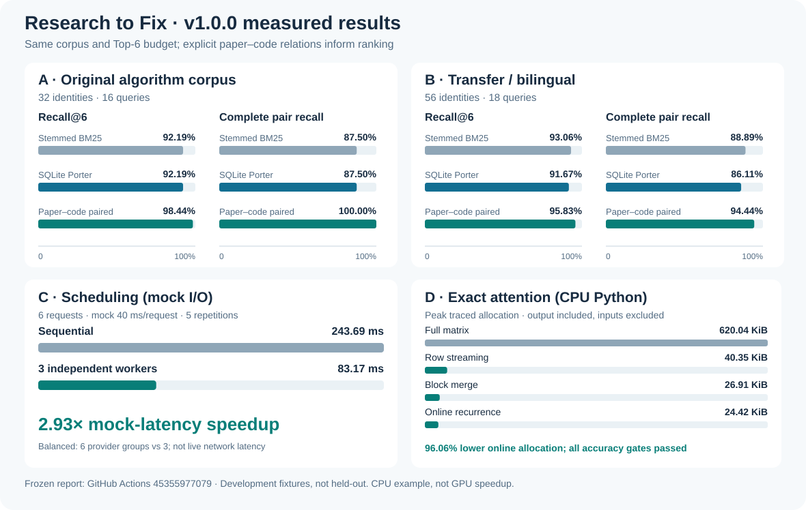
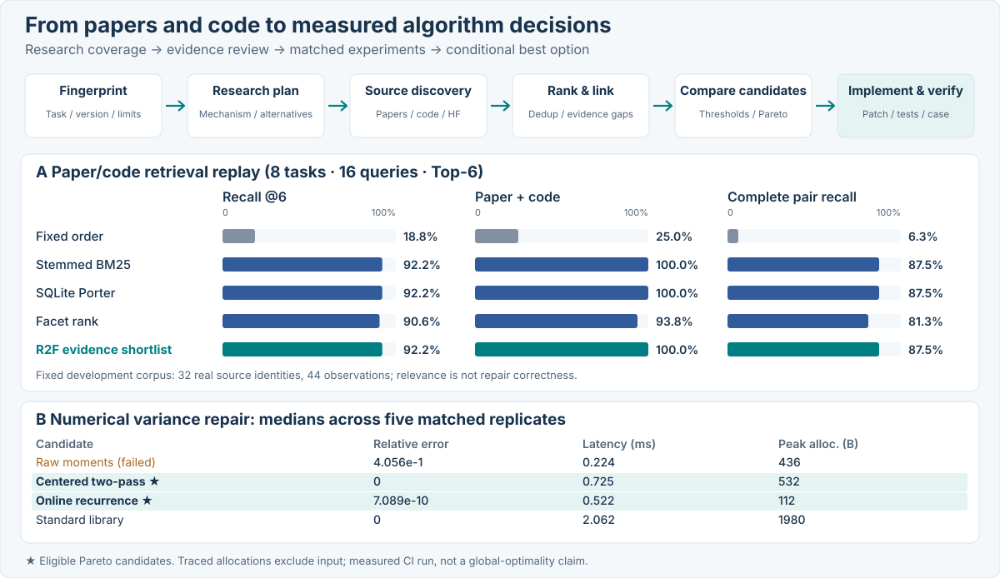
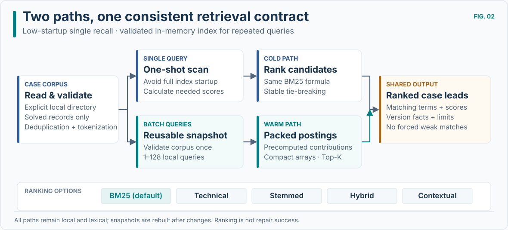
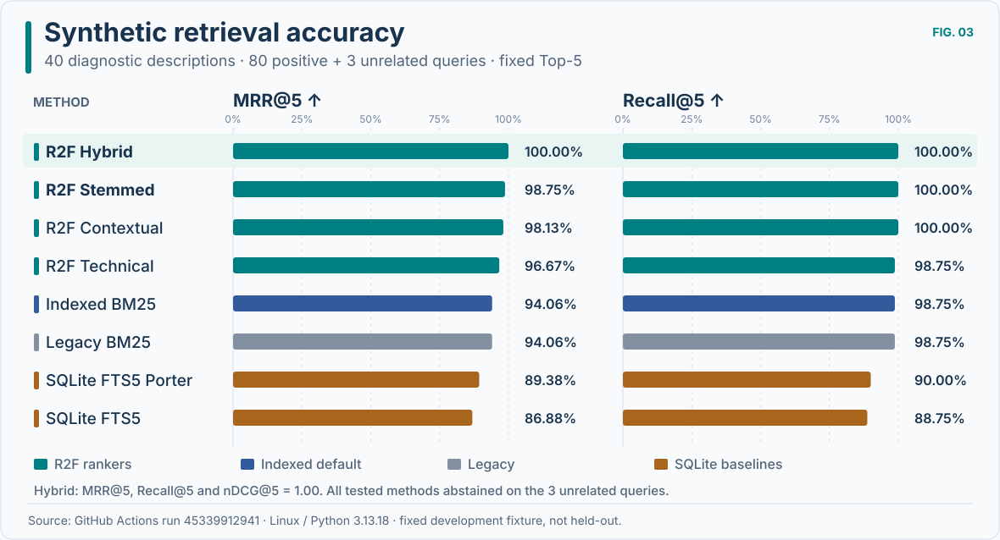
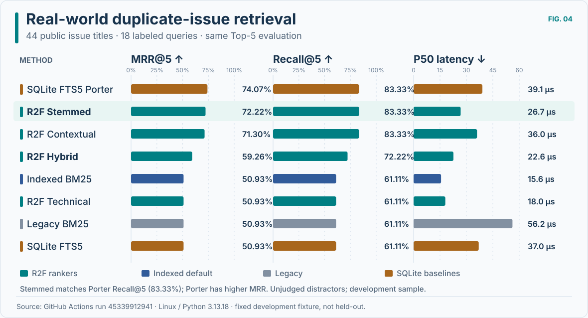
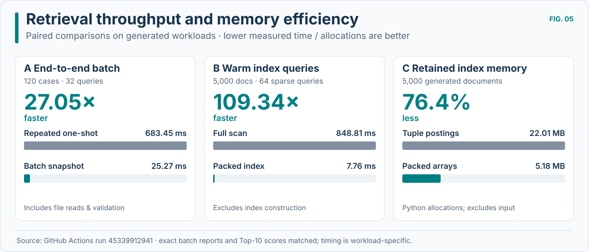

# Research to Fix

**From uncertain failures to evidence-backed repairs.**

[](https://github.com/Afloat16/research-to-fix/actions/workflows/checks.yml)
[](https://github.com/Afloat16/research-to-fix/actions/workflows/performance.yml)
[](LICENSE)
[](#installation)

**English** · [简体中文](README.zh-CN.md) · [Quick start](#installation) · [Benchmark results](#performance--evaluation) · [User guide](docs/USER_GUIDE.md)

**Research first. Repair with evidence. Prove what changed.** Research to Fix is an [Agent Skills](https://agentskills.io/specification) workflow for stubborn bugs, unfamiliar errors, failed reproductions, training instability, and performance regressions. Instead of asking an agent to guess a fix, it helps the agent find relevant prior work, map it to the current code, adapt or combine compatible solutions, and validate the result against the original failure and regressions.



*Figure 1. The host agent handles research and authorized execution; deterministic local helpers handle case retrieval, record checks and evidence packaging. Failed checks feed back into research.*

Concept and workflow design: [Afloat16](https://github.com/Afloat16). MIT licensed. **No mandatory Python third-party packages, hosted search service, or embedding model.**

## v1.0.0 — multi-round research and verified decisions



**98.44% / 95.83% Recall@6** on the original and transfer algorithm development fixtures using explicit paper–code pairing; **2.93×** simulated scheduling speedup; **96.06%** less peak traced allocation for online exact attention in the local CPU example. These are bounded, reproducible measurements, not universal repair accuracy or GPU speedup. [Measured run](https://github.com/Afloat16/research-to-fix/actions/runs/45355977079) · [frozen JSON](docs/figures/v1-snapshot.json) · [release notes](docs/releases/v1.0.0.md).

- Research sessions retain up to four rounds, distinct-query budgets, plan-bound payloads and coverage gaps. No automatic repeated requests.
- Optional public metadata discovery supports GitHub, arXiv, Crossref, Hugging Face, Semantic Scholar, OpenAlex and DBLP; balanced scheduling and up to four workers across independent provider groups are opt-in.
- Paired ranking promotes explicit implementation relations, not mere URL mentions. Conflicting identifiers and publication warnings are isolated for review. BM25 remains the compatible default.
- Protocol and candidate-design locks detect post-freeze changes; all-pairs Pareto compares matched replicates, preserving real tradeoffs.

**Live scope:** one authorized known-item probe returned 15 observations from GitHub, Crossref and OpenAlex, including the target paper DOI and code repository. arXiv was unavailable, Semantic Scholar rate-limited, DBLP returned an invalid response. [Probe run](https://github.com/Afloat16/research-to-fix/actions/runs/45355435962). This is an access smoke test, not a representative retrieval score. The optional API is not a full-text reader. Host browsing remains preferred.

## Where to start

| I want to… | Start here |
| --- | --- |
| Solve a difficult bug with an agent | [Install the skill](#installation) and [try a prompt](#usage) |
| Reuse earlier fixes | [Record and retrieve a case](#record-and-reuse-a-case) |
| Inspect the results and compare methods | [Performance & evaluation](#performance--evaluation) · [benchmark protocol](benchmarks/README.md) |
| Understand every command and evidence rule | [Detailed user guide](docs/USER_GUIDE.md) · [case template](skills/research-to-fix/references/case-template.md) |

## What it does

- **Research with a purpose:** fingerprint the failure, generate balanced queries, search relevant GitHub issues/PRs, Hugging Face, technical communities, original papers and authors, and separate reliable evidence from leads.
- **Reuse with judgment:** retrieve previously recorded cases, compare versions and mechanisms, and map candidate fixes to local files and symbols. Relevance is not proof of compatibility.
- **Repair and test:** preserve the original failure check and regression criteria; record alternative approaches, failed attempts and actual before/after outcomes.
- **Deliver auditable evidence:** check declared consistency, review missing evidence and test details, and optionally seal selected artifacts with SHA-256 manifests.

Read the [source playbook](skills/research-to-fix/references/source-playbook.md), [evidence rules](skills/research-to-fix/references/evidence-rules.md) and [repair workflow](skills/research-to-fix/references/repair-workflow.md) for the full methodology.

## Installation

Release archive: [v1.0.0 release and SHA-256 checksum](https://github.com/Afloat16/research-to-fix/releases/tag/v1.0.0). Extract the `research-to-fix/` directory into your host's skill directory. The archive contains the committed skill, license and version; it does not include experiment logs or local user data.

Use a host supporting the Agent Skills format. Verify your host's installation tool, then:

```bash
npx skills add Afloat16/research-to-fix --skill research-to-fix
```

Or clone this repository and copy `skills/research-to-fix/` into your host's skills directory. The helper commands require **Python 3.10+**. The host must provide its own search, browsing and execution capabilities (or explicitly authorize the optional fixed public-metadata adapter for discovery); the skill itself does not provide a crawler, credentials or model API.

## Usage

Try one of these requests in your agent host.

```text
Use $research-to-fix: Our multi-GPU training intermittently hangs.
Reproduce it, find related issues and fixes, compare versions and
mechanisms, adapt a compatible solution, and verify the original failure
and regression tests. Record any unresolved evidence or failed attempts.
```

```text
Use $research-to-fix: Our paper reproduction is below the reported result.
Check the original paper, author code, model/dataset configuration and
reproductions. Compare candidate approaches with identical data splits,
seeds and resource budgets, then test the best-supported change.
```

## Research-led algorithm optimization

**Find papers and real implementations, then compare repair routes instead of guessing.** For difficult algorithm, reproduction and performance problems, the new research-decision workflow plans mechanism, code, paper, verification, alternative and counterevidence searches. Host search is preferred; an optional explicitly approved public-metadata adapter supports GitHub, arXiv, Crossref, Hugging Face, Semantic Scholar, OpenAlex and DBLP without credentials (service access varies). Duplicate identities are collapsed, source and access provenance is retained, and explicit paper–code links and missing coverage guide the next search. Nothing in the ranking proves applicability.

```text
Use $research-to-fix to investigate this algorithmic bottleneck.
Identify relevant papers, author implementations and issue/PR history;
compare at least two distinct viable mechanisms if available.
Freeze the same dataset, seeds, metrics, hardware and acceptance checks.
Run authorized experiments, present the Pareto frontier and tradeoffs,
implement the best justified option, then verify and record the repair.
```

| Step | Helper |
| --- | --- |
| Bounded multi-round research | `research_session.py start / next / append / review` |
| Single public research plan | `research_workflow.py plan` |
| Optional approved public metadata discovery | `public_discovery.py` |
| Deduplicate, rank, link evidence and identify gaps | `research_workflow.py triage` |
| Freeze candidate design and compare measured alternatives | `solution_compare.py --freeze-design` / `--comparison` |



*Historical v0 development replay: 32 identities, 44 observations, 16 queries. The default evidence shortlist matches the stemmed BM25 baseline in Recall@6 (92.19%) and complete pair recall (87.5%); both achieve 100% paper-and-code coverage on this fixture. The standalone facet rank is weaker overall, so it remains optional. The five-replicate local variance experiment produces two eligible Pareto options, centered two-pass and online recurrence. [Measured CI run](https://github.com/Afloat16/research-to-fix/actions/runs/45343672697) · [Frozen report](docs/figures/research-snapshot.json). Not an independent evaluation of live APIs or general agent repair success.*

See the [complete workflow and JSON examples](skills/research-to-fix/references/research-decision.md), the [public paper/code benchmark](benchmarks/README.md#algorithm-discovery-and-decision), and the [reproducible numerical variance experiment](examples/numerical-variance/README.md). Network access remains opt-in; execution depends on the host and authorization. A result can be partial or blocked; no guarantee of universal repair success.

## Performance & evaluation

The retrieval engine has two execution paths: a low-startup scan for one query, and a reusable validated in-memory inverted index for batches. Five explainable lexical ranking modes preserve a compatibility-first default while enabling technical identifier expansion, English stemming, exact/stem fusion and phrase-aware experiments.



*Figure 2. Both paths share the default scoring semantics, deterministic tie-breaking, validation and candidate filtering. No persistent query cache; rebuild after the corpus changes.*

### Synthetic retrieval accuracy



*Figure 3. 40 authored diagnostic descriptions, 80 positive and three unrelated queries. Hybrid reaches 1.00 MRR@5, Recall@5 and nDCG@5 on this development fixture; all tested methods return no results on the three unrelated queries.*

### Real-world duplicate-issue retrieval



*Figure 4. 44 public issue titles, 18 labeled queries. Stemmed improves the legacy MRR@5 from 50.93% to 72.22% and Recall@5 from 61.11% to 83.33%. SQLite Porter has higher MRR (74.07%) and the same recall; Stemmed has lower observed median ranking latency (26.7 vs 39.1 µs). This is a small development sample with unjudged distractors, not a held-out benchmark.*

### Measured throughput & memory

**27.05×** faster repeated-case retrieval · **109.34×** faster warm sparse-index retrieval · **76.4%** lower retained index allocations in the paired workloads below.



*Figure 5. Latest recorded experiment: 120 synthetic case files × 32 queries; 5,000 generated documents × 64 sparse queries; retained Python allocations exclude the input corpus. Batch reports and Top-10 scores were identical. Warm-query timing excludes index construction; speedups are workload-specific.*

**Reproducibility.** Figures 3–5 use one frozen, completed [GitHub Actions performance run](https://github.com/Afloat16/research-to-fix/actions/runs/45339912941), Python 3.13.18 on Linux. See the [raw JSON snapshot](docs/figures/benchmark-snapshot.json), [performance evidence](docs/PERFORMANCE.md), [dataset provenance and commands](benchmarks/README.md) and [figure source](docs/figures/README.md). The last evaluated code ran 166 helper tests and six example tests, with all seven OS/Python CI jobs passing ([test run](https://github.com/Afloat16/research-to-fix/actions/runs/45339912917)).

> These are retrieval and resource benchmarks, not agent repair-success scores. Both ranking fixtures were used during development; neither establishes universal superiority. The optional BEIR adapter is available, but a successful external BEIR run and a matched SWE-bench repair evaluation have not yet been demonstrated.

## Record and reuse a case

From the repository root, run an actual failing/fixed comparison on the bundled streaming example. Choose a new output directory:

```bash
python examples/streaming-metrics/record_case.py --output /tmp/r2f-case
python skills/research-to-fix/scripts/research_case.py validate /tmp/r2f-case/case.json
python skills/research-to-fix/scripts/research_case.py recall \
  --cases-dir /tmp/r2f-case --error 'single-use iterator count mean' --format markdown
```

The example records actual commands, exits, per-test results, logs and snapshots from the broken and fixed implementations. [Read the full example](examples/streaming-metrics/README.md). Recall only reads the explicit top-level case directory and considers structurally valid records declaring `solved`.

## High-throughput recall and measured ranking

For multiple related questions, supply a separate JSON file containing 1–128 query strings (do not store the query file in the case corpus):

```bash
python skills/research-to-fix/scripts/research_case.py recall-batch \
  --cases-dir ./cases --queries-file ./queries.json --ranking stemmed
```

| Mode | Choose when… |
| --- | --- |
| `bm25` (default) | You need the exact legacy ranking contract |
| `technical` | Identifier variants and symptom emphasis matter |
| `stemmed` | English inflections obscure related issue titles |
| `hybrid` | Exact technical tokens and stemming both matter |
| `contextual` | You want to experiment with ordered phrase signals |

Use the [case reuse guide](skills/research-to-fix/references/case-reuse.md) for limits, score interpretation and snapshot behavior. No ranker establishes repair correctness.

## Helper tools

The standard-library CLI, `skills/research-to-fix/scripts/research_case.py`, provides:

| Command | Purpose |
| --- | --- |
| `queries` | Offline bilingual research plan; review before sending to public services |
| `init` | Create a new blocked case template without overwriting |
| `recall` / `recall-batch` | Local case leads for one or multiple queries |
| `validate` | Check schema v1 declarations and reference consistency |
| `review` | Report missing evidence, comparison context or test details |

See [command examples and options](docs/USER_GUIDE.md#helper-tools).

## Review and preserve evidence

```bash
python skills/research-to-fix/scripts/research_case.py review /tmp/r2f-case/case.json
python skills/research-to-fix/scripts/case_bundle.py seal --directory /tmp/r2f-case
python skills/research-to-fix/scripts/case_bundle.py verify --directory /tmp/r2f-case
```

The evidence helper seals `case.json`, declared run artifacts and explicitly supplied files; verify checks bytes against the manifest, not authorship or the truth of experimental claims. Retain the manifest digest independently if you need tamper detection relative to that digest. Read the [evidence bundle guide](skills/research-to-fix/references/evidence-bundle.md) and [security policy](SECURITY.md). Review and redact all material before sharing.

## Project structure

```text
skills/research-to-fix/    Agent skill, references, offline Python tools
examples/                 Reproducible repair examples
benchmarks/               Labeled datasets, baselines, performance gates
docs/figures/             Reproducible vector graphics and measured data
docs/                     User guide, methodology and release criteria
tests/                    Regression and behavior tests
```

## Validation and contributions

```bash
python -m unittest discover -s tests -v
python -m unittest discover -s examples/streaming-metrics -v
```

For comparative experiments, follow the [benchmark protocol](benchmarks/README.md). Contributions with real reproductions, comparable checks, source links, documented limitations and carefully redacted case evidence are welcome. See [CONTRIBUTING](CONTRIBUTING.md), [CODE OF CONDUCT](CODE_OF_CONDUCT.md), [SECURITY](SECURITY.md), [release checklist](docs/RELEASE_CHECKLIST.md), and [CHANGELOG](CHANGELOG.md).

## License

[MIT](LICENSE).

## Related projects

Explore the [Afloat16 project guide](docs/PROJECTS.md), [demand review](docs/DEMAND_REVIEW.md) and [outreach record](docs/OUTREACH.md).
