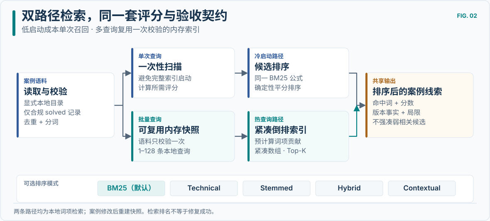
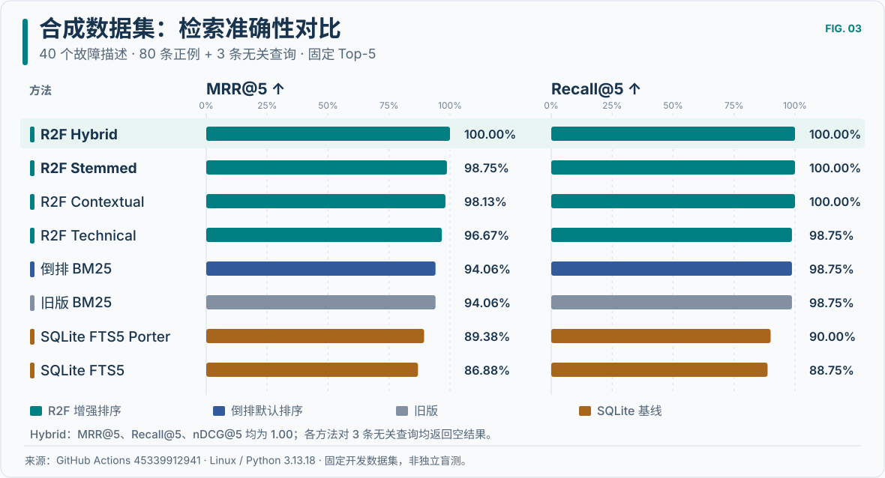

# Research to Fix

**从难以定位的故障，到有证据、可验证、可复用的修复。**

[](https://github.com/Afloat16/research-to-fix/actions/workflows/checks.yml)
[](https://github.com/Afloat16/research-to-fix/actions/workflows/performance.yml)
[](LICENSE)
[](#安装)

[English](README.md) · **简体中文** · [快速安装](#安装) · [基准实验](#性能与实验) · [详细使用手册](docs/USER_GUIDE.zh-CN.md)

**先研究，再循证修复，最后用实验说话。** Research to Fix 是遵循 [Agent Skills](https://agentskills.io/specification) 格式的循证研究与修复工作流，适用于陌生报错、疑难 Bug、论文复现失败、训练异常和性能退化。它让 Agent 不只是猜测解决方案，而是调查可借鉴的先前工作，将证据映射到当前代码，适配或组合可行方案，并对照原症状和回归测试验证结果。


*图 1｜宿主 Agent 承担研究和授权执行，本地确定性工具负责案例召回、记录检查与证据封存；验证失败则反馈到研究环节。*

创意与工作流设计：[Afloat16](https://github.com/Afloat16)。MIT 开源。**不要求 Python 第三方运行时依赖、托管搜索服务或向量模型。**

## 从哪里开始

| 我想… | 从这里开始 |
| --- | --- |
| 让 Agent 调研并修复疑难问题 | [安装 Skill](#安装) · [示例请求](#使用) |
| 复用以往修复经验 | [记录案例并检索复用](#记录案例并检索复用) |
| 比较算法和真实实验数据 | [性能与实验](#性能与实验) · [基准协议](benchmarks/README.md) |
| 了解全部命令和证据规则 | [详细使用手册](docs/USER_GUIDE.zh-CN.md) · [案例模板](skills/research-to-fix/references/case-template.md) |

## 它做什么

- **有目的地研究：** 提取问题指纹，规划均衡查询，按相关性检索 GitHub Issue/PR、Hugging Face、技术社区、原始论文与作者资料，区分可靠证据和待核实线索。
- **有判断地复用：** 召回历史案例，比较版本与机制，把候选解决方案映射到本地文件与符号；相关性不能证明兼容性。
- **可比较地修复：** 保留原症状检查和回归验收标准，记录候选方案、失败轮次与实际前后结果。
- **可审计地交付：** 检查案例声明的一致性、复核证据和测试明细的缺口，并可选用 SHA-256 清单封存指定产物。

完整方法见[来源检索指南](skills/research-to-fix/references/source-playbook.md)、[证据判定](skills/research-to-fix/references/evidence-rules.md)和[修复流程](skills/research-to-fix/references/repair-workflow.md)。

## 安装

使用支持 Agent Skills 格式的宿主。核对安装工具后运行：

```bash
npx skills add Afloat16/research-to-fix --skill research-to-fix
```

也可克隆仓库，将 `skills/research-to-fix/` 完整复制到宿主的 Skill 目录。辅助工具要求 **Python 3.10+**。搜索、浏览和执行能力主要由宿主提供；可选公开元数据检索需明确授权，本项目不捆绑爬虫、登录凭据或模型 API。

## 使用

在支持的宿主 Agent 中试试：

```text
使用 $research-to-fix：我们的多 GPU 训练偶发卡死。
先复现并记录环境，调研相关 Issue 和修复 PR，比较版本与机制，
适配兼容的解决方案，再验证原始故障和回归测试。
记录证据缺口与失败的迭代轮次。
```

```text
使用 $research-to-fix：论文复现结果明显低于作者报告。
查原始论文、作者代码、模型/数据配置和复现讨论，
在相同数据切分、随机种子和资源预算下比较候选方案，
最后验证最有证据支持的改动。
```

## 面向算法研究者的研究—决策引擎

**找论文、找原始开源实现、找替代机制，再用同条件实验选方案。** 针对算法瓶颈、复现失败和性能退化，新增研究计划、可选的公开 API 元数据发现、跨来源去重排序、论文—代码关联图、证据缺口诊断以及实测多方案决策。优先使用宿主真实联网搜索；只在脱敏查询获授权后启用固定公开 API。

```text
使用 $research-to-fix 优化这个算法瓶颈。
调研相关论文、作者开源实现、Issue/PR 和失败案例。
至少比较两个不同机制的可行方案（如有）。
固定数据集、随机种子、硬件、指标和验收阈值，实际进行同条件实验。
展示 Pareto 最优方案、精度/耗时/资源取舍，实施最合适的方案，
最后运行原始故障与回归测试并保存证据。
```

| 环节 | 工具 |
| --- | --- |
| 公开问题指纹与查询规划 | `research_workflow.py plan` |
| 明确授权后检索公开元数据 | `public_discovery.py` |
| 去重、排序、证据关联与缺口发现 | `research_workflow.py triage` |
| 同条件实测多方案比较 | `solution_compare.py` |

查看[完整用法与 JSON 格式](skills/research-to-fix/references/research-decision.md)、[论文/开源来源基准](benchmarks/README.md#algorithm-discovery-and-decision)及[真实数值方差修复实验](examples/numerical-variance/README.md)。联网与执行依赖宿主能力及授权；不能保证任何算法问题必定解决。

## 性能与实验

检索引擎采用双路径架构：单次查询使用低启动成本扫描；批量查询复用一次校验的内存倒排索引。五种可解释词项排序兼顾兼容性、技术标识符扩展、英文词形归一、精确词/词干融合及短语特征实验。



*图 2｜两条路径共享默认评分公式、确定性平分排序、案例校验与候选过滤。不持久化查询缓存；案例修改后重新构建快照。*

### 合成数据集：检索准确性对比



*图 3｜40 个故障描述、80 条正例查询和 3 条无关查询。Hybrid 在这组开发样本上 MRR@5、Recall@5、nDCG@5 均为 1.00；所有受测方法对三条无关查询均返回空结果。*

### 真实公开 Issue：检索质量与速度对比


*图 4｜44 个公开 Issue 标题、18 条有标签查询。Stemmed 将旧版 MRR@5 从 50.93% 提升至 72.22%，Recall@5 从 61.11% 提升至 83.33%。SQLite Porter 的 MRR 更高（74.07%）、召回率相同；Stemmed 的实测中位检索延迟更低（26.7 vs 39.1 µs）。该小样本含未标注干扰项，不是独立盲测。*

### 实测吞吐量与内存

**27.05×** 批量案例召回加速 · **109.34×** 稀疏索引热查询加速 · **76.4%** 索引常驻分配内存下降（对应以下配对负载）。


*图 5｜最近一次已记录实验：120 个合成案例 × 32 条查询；5,000 个生成文档 × 64 条稀疏查询。批量报告与 Top-10 评分完全一致。内存不含输入语料；热查询不含索引构建时间，加速比只对应此负载。*

**可复现性。** 图 3–5 的数字来自同一次已完成的 [GitHub Actions 性能实验](https://github.com/Afloat16/research-to-fix/actions/runs/45339912941)，环境为 Linux / Python 3.13.18。参阅[原始 JSON 快照](docs/figures/benchmark-snapshot.json)、[性能技术报告](docs/PERFORMANCE.md)、[数据集来源和复现命令](benchmarks/README.md)及[图表生成源码](docs/figures/README.md)。该实验对应代码运行了 166 项辅助工具测试和 6 项示例测试，七个操作系统/Python CI 组合均通过（[测试记录](https://github.com/Afloat16/research-to-fix/actions/runs/45339912917)）。

> 检索和资源开销指标不等于 Agent 修复成功率。两套排名样本均用于开发迭代，不能据此宣称全面领先。BEIR 适配器已经实现，但尚未完成外部 BEIR 评测及同条件 SWE-bench 修复对比。

## 记录案例并检索复用

从仓库根目录执行内置流式统计示例的实际故障/修复对比，选择一个不存在的输出目录：

```bash
python examples/streaming-metrics/record_case.py --output /tmp/r2f-case
python skills/research-to-fix/scripts/research_case.py validate /tmp/r2f-case/case.json
python skills/research-to-fix/scripts/research_case.py recall \
  --cases-dir /tmp/r2f-case --error 'single-use iterator count mean' --format markdown
```

示例保留故障版与修复版的实际命令、退出码、逐测试结果、日志和源码快照。[查看完整案例](examples/streaming-metrics/README.md)。召回仅访问显式案例目录顶层，且只考虑结构校验通过并声明为 `solved` 的记录。

## 高吞吐召回与实测排序

多条相关查询使用单独的 JSON 文件（1–128 条字符串，不要放在案例语料目录内）：

```bash
python skills/research-to-fix/scripts/research_case.py recall-batch \
  --cases-dir ./cases --queries-file ./queries.json --ranking stemmed
```

| 模式 | 适用场景 |
| --- | --- |
| `bm25`（默认） | 保持旧版精确评分与排序契约 |
| `technical` | 技术标识符变体和原症状加权 |
| `stemmed` | 英文词形变化影响相似问题匹配 |
| `hybrid` | 同时保留精确技术词与词干特征 |
| `contextual` | 尝试有序短语信号 |

具体限制、评分解释及快照行为见[本地案例复用指南](skills/research-to-fix/references/case-reuse.md)。任何排序均不证明修复正确性。

## 辅助工具

标准库 CLI `skills/research-to-fix/scripts/research_case.py` 提供：

| 命令 | 用途 |
| --- | --- |
| `queries` | 离线中英文研究计划；对外发送前需人工复核 |
| `init` | 创建新的 blocked 案例模板，不覆盖已有文件 |
| `recall` / `recall-batch` | 单条或批量本地案例召回 |
| `validate` | 检查 schema v1 声明与引用一致性 |
| `review` | 复核证据、比较条件及测试细节缺口 |

[查看完整命令和参数](docs/USER_GUIDE.zh-CN.md#辅助工具)。

## 完整性复核与证据封存

```bash
python skills/research-to-fix/scripts/research_case.py review /tmp/r2f-case/case.json
python skills/research-to-fix/scripts/case_bundle.py seal --directory /tmp/r2f-case
python skills/research-to-fix/scripts/case_bundle.py verify --directory /tmp/r2f-case
```

证据工具封存 `case.json`、声明的运行产物和显式选择的文件。验证检查文件字节是否与清单一致，而不认证作者或实验真实性。需要检测相对于原清单的篡改时，应独立保存清单摘要。参见[证据包指南](skills/research-to-fix/references/evidence-bundle.md)和[安全政策](SECURITY.md)。分享前人工复核脱敏。

## 项目结构

```text
skills/research-to-fix/    Agent Skill、参考资料、离线工具与可选公开检索
examples/                 可复现修复实例
benchmarks/               标签数据集、基线算法与性能门禁
docs/figures/             可再生成矢量图与原始实测数据
docs/                     使用手册、实验方法与发布标准
tests/                    回归与行为测试
```

## 验证与贡献

```bash
python -m unittest discover -s tests -v
python -m unittest discover -s examples/streaming-metrics -v
```

对比实验请遵循[基准协议](benchmarks/README.md)。欢迎贡献真实复现、可比较的验收检查、来源链接、明确局限和经过脱敏的案例。参见[贡献指南](CONTRIBUTING.md)、[行为准则](CODE_OF_CONDUCT.md)、[安全政策](SECURITY.md)、[发布清单](docs/RELEASE_CHECKLIST.md)与[变更记录](CHANGELOG.md)。

## 许可

[MIT](LICENSE)。

## 相关开源项目

浏览 [Afloat16 项目导航](docs/PROJECTS.zh-CN.md)、[需求调研](docs/DEMAND_REVIEW.zh-CN.md)和[推广记录](docs/OUTREACH.zh-CN.md)。
