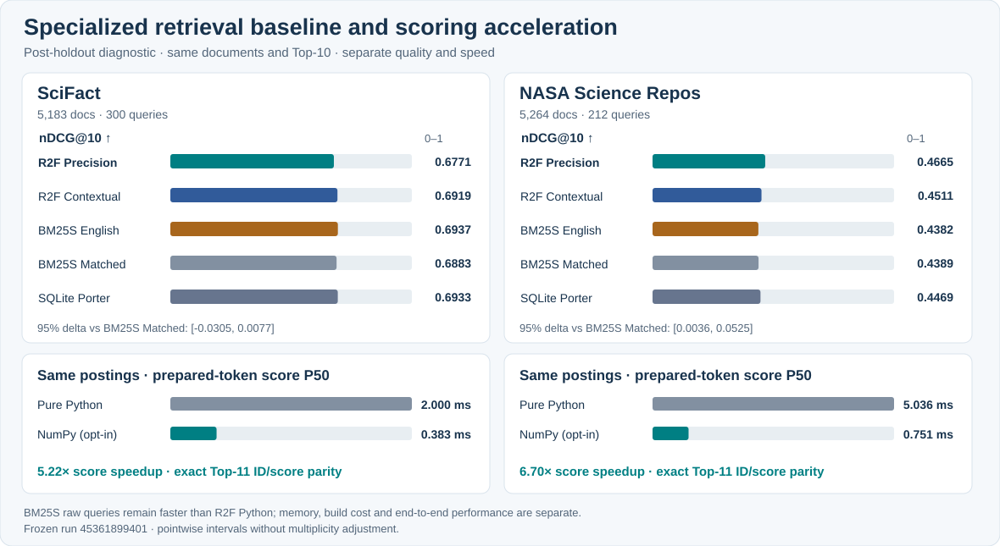

# Specialized retrieval competitor diagnostic / 专用检索对照

This is a **post-holdout diagnostic**, not a new blind test. See [BM25S protocol](BM25S_PROTOCOL.md) and the [original four-corpus held-out evaluation](INDEPENDENT_RESULTS.md). All measurements below come from [run 45361899401](https://github.com/Afloat16/research-to-fix/actions/runs/45361899401), job 138333776080, commit `bd4595cd1e31a82611ef2afd8561716c72d19f77`, Linux CPython 3.13.18, BM25S 0.2.14, NumPy 2.2.6 and SciPy 1.15.3. The [frozen JSON](../docs/figures/competitor-snapshot.json) preserves every method, source digest, timing and pointwise interval.



## Same-corpus retrieval results

| Dataset | Method | nDCG@10 | Recall@10 | MRR@10 | Build (s) | P50 (ms) | P95 (ms) |
| --- | --- | ---: | ---: | ---: | ---: | ---: | ---: |
| scifact | bm25s_native | 0.6937 | 0.8312 | 0.6564 | 2.264 | 0.1623 | 0.4677 |
| scifact | bm25s_matched | 0.6883 | 0.8281 | 0.6526 | 1.748 | 0.1265 | 0.4344 |
| scifact | precision_field4 | 0.6771 | 0.8172 | 0.6396 | 5.987 | 2.0783 | 4.2052 |
| scifact | v1_contextual | 0.6919 | 0.8365 | 0.6528 | 4.625 | 1.6288 | 3.1440 |
| scifact | sqlite_porter | 0.6933 | 0.8262 | 0.6577 | 0.735 | 5.5855 | 9.7117 |
| scifact | sqlite_unicode4 | 0.6741 | 0.7949 | 0.6416 | 0.736 | 3.9965 | 8.2058 |
| nasa | bm25s_native | 0.4382 | 0.5622 | 0.4047 | 4.324 | 0.1736 | 0.2171 |
| nasa | bm25s_matched | 0.4389 | 0.5721 | 0.4040 | 5.353 | 0.1435 | 0.1848 |
| nasa | precision_field4 | 0.4665 | 0.5993 | 0.4331 | 16.079 | 5.7306 | 9.1542 |
| nasa | v1_contextual | 0.4511 | 0.5847 | 0.4160 | 12.406 | 3.6900 | 5.4394 |
| nasa | sqlite_porter | 0.4469 | 0.5825 | 0.4107 | 2.622 | 13.7468 | 17.9382 |
| nasa | sqlite_unicode4 | 0.4307 | 0.5511 | 0.3958 | 2.565 | 11.8252 | 14.7812 |

Precision Field leads the measured methods on NASA (5,264 documents, 212 positively judged queries; 7 unjudged excluded explicitly). Its nDCG improvement over BM25S Matched is 6.27%, with paired pointwise 95% interval [0.0036, 0.0525]. SciFact (5,183 documents, 300 judged queries) favors BM25S English in point estimate; the Precision vs BM25S intervals cross zero. BM25S remains substantially faster in raw queries and builds. These lexical baselines are not dense models or agent systems.

## Fix the query scoring bottleneck without changing ranking

An explicit optional `NumpyRanker` adapter traverses the original positive BM25 postings in sorted term order, preserves float64 compensated accumulation on CPython 3.12+, and resolves ties by document ID. Explanation requests use the standard-library path. Ordinary tools do not import NumPy. The benchmark prepares identical query terms, compares exact Top-11 scores and IDs (not merely nDCG) on every query, then alternates three timing passes.

| Dataset | Queries | Python P50 ms | NumPy P50 ms | P50 speedup | P95 speedup | Adapter setup (s) | Top-11 parity |
| --- | ---: | ---: | ---: | ---: | ---: | ---: | --- |
| scifact | 300 | 1.9998 | 0.3828 | 5.22× | 5.94× | 1.847 | Exact |
| nasa | 212 | 5.0356 | 0.7511 | 6.70× | 7.37× | 4.235 | Exact |

Scratch arrays use O(corpus size) memory plus persistent per-term read-only views. Adapter setup and full index construction are not in the prepared-query timing. The optional NumPy path was actually exercised on Linux CPython 3.13 in this run; the standard-library CLI retains its seven-environment CI coverage. This is not a claim that the vector scorer is faster than BM25S, that every runtime has equal performance, or that the host agent's repair is faster. It is a reproducible speedup of the same R2F scoring implementation.

## Reproduce

In an isolated benchmark environment, after explicit authorization for public data/package downloads:

```bash
python -m pip install --only-binary=:all: -r benchmarks/requirements-bm25s.txt
python -m unittest discover -s tests -p test_numpy_rank.py -v
python benchmarks/independent_data.py --dataset scifact --output /tmp/scifact-new
python benchmarks/compare_bm25s.py --data /tmp/scifact-new --output /tmp/scifact-bm25s.json
python benchmarks/vector_parity.py --data /tmp/scifact-new --output /tmp/scifact-vector.json
```

Repeat for NASA with new paths. Do not tune on already viewed test data. Use another external split to assess new ranking changes. Real matched model/agent repair evaluation and dense model comparisons are not yet executed.

中文：NASA 上新排序优于所测 BM25S，但 SciFact 未显示领先；BM25S 原始查询速度仍更强。可选 NumPy 在相同倒排索引上保持 512 条查询的 Top-11 文档与分数精确一致，改善预分词评分耗时，不替代默认 CLI。完整记录不利结果、额外初始化和内存成本。
