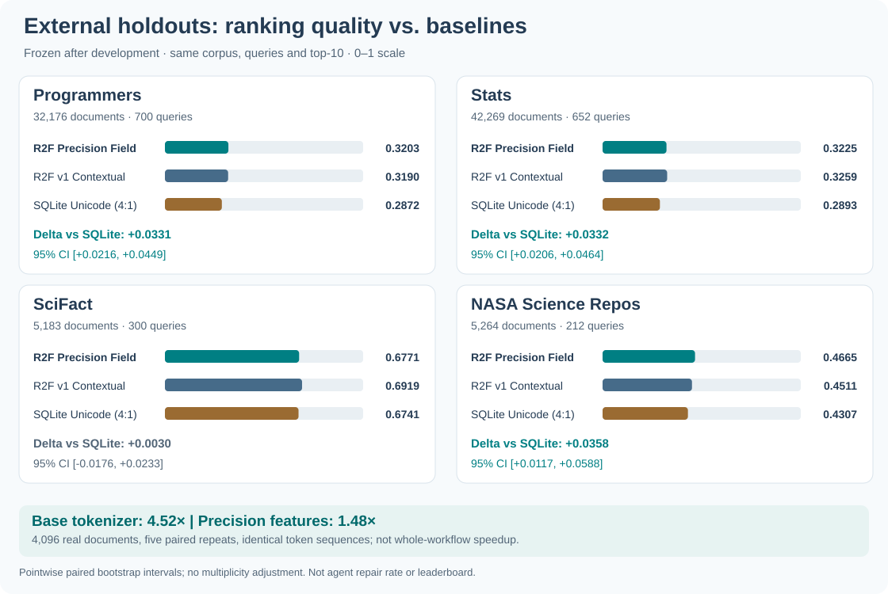

# External retrieval evidence / 外部保留集实测

## Scope

This is an external, held-out lexical retrieval comparison, not a global ranking leaderboard or end-to-end agent repair experiment. The frozen v1.0.0 baseline is `b641383a2bfe8711347386e6c4cac5768608ab65`. The selection rule, dataset revisions, exact developer set and selected methods are recorded in [INDEPENDENT_PROTOCOL.md](INDEPENDENT_PROTOCOL.md) and [independent_selection.json](independent_selection.json). 176 Programmers queries were used for development; 700 different Programmers queries and all judged Stats, SciFact and NASA queries were untouched during parameter selection. These are public benchmarks, not secret blind labels.

The primary metric is nDCG@10. Methods search the same document fields with the declared character caps, no query metadata or relevance labels as features. Precision Field combines exact, stem and phrase features with independent field normalization (title 4, body 1). SQLite title weights 2, 4 and 8 were explored on the same development queries; Unicode weight 4 was selected by the same nDCG rule. The full method grid and losing development results are retained. Both the strongest prior R2F mode and default SQLite Unicode/Porter are included.

## Frozen holdout result

84,892 documents in four full corpora; 1,864 positively judged queries. Actual [CI run 45359141496](https://github.com/Afloat16/research-to-fix/actions/runs/45359141496), job 138324408563, commit `0b826705016a1dadce95f02fddfd23c0ff8fe599`. All four datasets completed. [Exact JSON summary](../docs/figures/independent-snapshot.json) preserves full metrics, manifests, dataset file digests and pointwise paired intervals; the CI artifact contains query IDs, rankings and scores, without corpus text. No final-set retuning.

| Dataset | Documents | Queries | R2F Precision nDCG@10 | Tuned SQLite nDCG@10 | v1 Contextual nDCG@10 | Relative vs tuned SQLite | Paired 95% delta interval |
|---|---:|---:|---:|---:|---:|---:|---:|
| Programmers | 32,176 | 700 | 0.3203 | 0.2872 | 0.3190 | 11.52% | [0.0216, 0.0449] |
| Stats | 42,269 | 652 | 0.3225 | 0.2893 | 0.3259 | 11.49% | [0.0206, 0.0464] |
| SciFact | 5,183 | 300 | 0.6771 | 0.6741 | 0.6919 | 0.44% | [-0.0176, 0.0233] |
| NASA Science Repos | 5,264 | 212 | 0.4665 | 0.4307 | 0.4511 | 8.32% | [0.0117, 0.0588] |



**What is supported:** against the preselected tuned SQLite baseline, the precision ranker has positive pointwise 95% paired-bootstrap intervals on Programmers, Stats and NASA. On SciFact the interval crosses zero. The strongest measured point estimate across all six methods is Precision Field on Programmers and NASA, v1 Contextual on Stats, and SQLite Porter on SciFact. The new ranker has no clear statistically supported improvement over v1 Contextual on any of the four (all four paired intervals include zero). The NASA advantage versus SQLite Porter also has an interval crossing zero. Intervals are query-level, pointwise and unadjusted for multiple comparisons; no universal claim.

**Tradeoffs:** precision field median warm query latency is lower than the frozen tuned SQLite in each corpus, but its p95 and total query times are worse on Programmers and Stats. Building the richer index is much slower than SQLite. Legacy mode and default ranking remain unchanged. The later feature-extraction optimization has exact sequence parity; these holdout timings remain timings of the frozen implementation, not of the later optimized build.

## All method results

### Programmers

32176 documents, 700 evaluated queries. 

| Method | nDCG@10 | Recall@10 | MRR@10 | Hit@10 | Build (s) | Query p50 (ms) | Query p95 (ms) | Total queries (s) |
|---|---:|---:|---:|---:|---:|---:|---:|---:|
| precision_field4 | 0.3203 | 0.3912 | 0.3278 | 0.4614 | 39.88 | 39.17 | 95.16 | 31.60 |
| sqlite_unicode4 | 0.2872 | 0.3603 | 0.2903 | 0.4271 | 3.01 | 40.29 | 73.84 | 27.73 |
| v1_contextual | 0.3190 | 0.3943 | 0.3252 | 0.4657 | 25.98 | 30.85 | 71.20 | 25.62 |
| v1_bm25 | 0.2903 | 0.3643 | 0.2923 | 0.4286 | 5.59 | 26.43 | 69.92 | 20.91 |
| sqlite_unicode | 0.2881 | 0.3698 | 0.2878 | 0.4343 | 2.98 | 40.57 | 73.49 | 27.87 |
| sqlite_porter | 0.3002 | 0.3818 | 0.2996 | 0.4500 | 2.96 | 45.53 | 76.71 | 31.19 |

### Stats

42269 documents, 652 evaluated queries. 

| Method | nDCG@10 | Recall@10 | MRR@10 | Hit@10 | Build (s) | Query p50 (ms) | Query p95 (ms) | Total queries (s) |
|---|---:|---:|---:|---:|---:|---:|---:|---:|
| precision_field4 | 0.3225 | 0.3860 | 0.3207 | 0.4233 | 45.92 | 40.35 | 113.57 | 31.75 |
| sqlite_unicode4 | 0.2893 | 0.3600 | 0.2842 | 0.3988 | 4.68 | 42.54 | 90.42 | 28.83 |
| v1_contextual | 0.3259 | 0.4020 | 0.3178 | 0.4387 | 30.43 | 35.28 | 88.75 | 27.29 |
| v1_bm25 | 0.2877 | 0.3588 | 0.2826 | 0.4003 | 7.98 | 25.49 | 93.37 | 21.23 |
| sqlite_unicode | 0.2898 | 0.3605 | 0.2848 | 0.4018 | 4.50 | 42.59 | 88.84 | 28.82 |
| sqlite_porter | 0.2935 | 0.3742 | 0.2846 | 0.4141 | 4.58 | 51.09 | 94.89 | 33.44 |

### SciFact

5183 documents, 300 evaluated queries. 

| Method | nDCG@10 | Recall@10 | MRR@10 | Hit@10 | Build (s) | Query p50 (ms) | Query p95 (ms) | Total queries (s) |
|---|---:|---:|---:|---:|---:|---:|---:|---:|
| precision_field4 | 0.6771 | 0.8172 | 0.6396 | 0.8400 | 8.58 | 2.96 | 6.17 | 0.94 |
| sqlite_unicode4 | 0.6741 | 0.7949 | 0.6416 | 0.8167 | 0.93 | 5.75 | 11.03 | 1.72 |
| v1_contextual | 0.6919 | 0.8365 | 0.6528 | 0.8567 | 5.62 | 2.41 | 4.88 | 0.77 |
| v1_bm25 | 0.6646 | 0.7823 | 0.6333 | 0.8033 | 1.48 | 1.69 | 3.99 | 0.56 |
| sqlite_unicode | 0.6726 | 0.7923 | 0.6400 | 0.8133 | 0.92 | 5.65 | 11.03 | 1.70 |
| sqlite_porter | 0.6933 | 0.8262 | 0.6577 | 0.8467 | 0.93 | 7.28 | 12.22 | 2.20 |

### NASA Science Repos

5264 documents, 212 evaluated queries. 219 published queries; 7 have no positive qrel and are reported as unjudged, not graded failures or successes.

| Method | nDCG@10 | Recall@10 | MRR@10 | Hit@10 | Build (s) | Query p50 (ms) | Query p95 (ms) | Total queries (s) |
|---|---:|---:|---:|---:|---:|---:|---:|---:|
| precision_field4 | 0.4665 | 0.5993 | 0.4331 | 0.6179 | 22.66 | 7.16 | 11.73 | 1.59 |
| sqlite_unicode4 | 0.4307 | 0.5511 | 0.3958 | 0.5708 | 3.20 | 14.45 | 18.05 | 3.03 |
| v1_contextual | 0.4511 | 0.5847 | 0.4160 | 0.6038 | 14.96 | 5.53 | 8.73 | 1.19 |
| v1_bm25 | 0.4143 | 0.5548 | 0.3765 | 0.5708 | 4.01 | 4.07 | 6.25 | 0.93 |
| sqlite_unicode | 0.4262 | 0.5511 | 0.3900 | 0.5708 | 3.22 | 14.77 | 18.56 | 3.09 |
| sqlite_porter | 0.4469 | 0.5825 | 0.4107 | 0.6038 | 3.26 | 16.24 | 20.91 | 3.44 |


## Exact-parity performance optimization

[Development run 45358476313](https://github.com/Afloat16/research-to-fix/actions/runs/45358476313): 4,096 documents, five paired repeats, 543,739 base tokens exactly equal; 624.716628 ms vs 118.366463 ms (5.278x). [Parity run 45360121033](https://github.com/Afloat16/research-to-fix/actions/runs/45360121033): same fixed sample, 711.672397 ms vs 157.608139 ms (4.515x); 1,498,281 precision-feature tokens exactly equal, 1,374.371629 ms vs 930.143969 ms (1.478x). These are within-run tokenizer/feature timings only, not full indexing or repair speed. Separate runs illustrate variability. The integration checks cover old Unicode sequences, BM25F reference parity, exact feature sequence, top-k, batch/single equality, deduplicated mirrors, abstention and publication-warning exclusion.

## Reproduction and remaining work

Run the command below only when authorized to download the fixed public datasets. No user data or model credential is sent. The suite validates manifests and reports all dataset failures, preserves the exact frozen selection, and does not execute downloaded code.

```bash
python benchmarks/independent_suite.py --selection benchmarks/independent_selection.json --output /tmp/r2f-external-new
```

The NASA dataset card identifies 5,264 repositories and 219 expert queries; seven queries have no positive qrel in the pinned three partitions, leaving 212 in the graded set. See [NASA benchmark](https://huggingface.co/datasets/nasa-impact/nasa-science-repos-sme-benchmark) and [paper](https://arxiv.org/abs/2607.05443). Other datasets: [BEIR](https://openreview.net/forum?id=wCu6T5xFjeJ), [CQADupStack](https://huggingface.co/datasets/BeIR/cqadupstack), [SciFact](https://huggingface.co/datasets/BeIR/scifact). The local field caps differ from some published benchmark pipelines; these results must not be compared directly to published leaderboard numbers.

End-to-end same-model paired SWE-bench evaluation remains **not executed**: see [AGENT_TRIAL_PROTOCOL.md](AGENT_TRIAL_PROTOCOL.md). The importer and its synthetic tests verify result-accounting semantics only. Real model runs, fixed budgets, isolated processes, official evaluator reports, and cost tracking are required. Dense retrieval competitors and live provider accuracy have not been tested here. Treat final-set failures as future development evidence; a newly tuned algorithm requires another independently held-out set.

中文：本轮冻结测试在四套公开语料上全部完成。对预先选定的 SQLite 方案，程序设计、统计学和 NASA 的点态置信区间均为正；SciFact 未证明显著优势。新版与旧 Contextual 四组差值区间均跨零，故不强制替换默认算法。已加入可选精确字段排序和语义完全一致的分词/特征提取优化。不得将排序准确率解释为 Agent 实际修复率。
